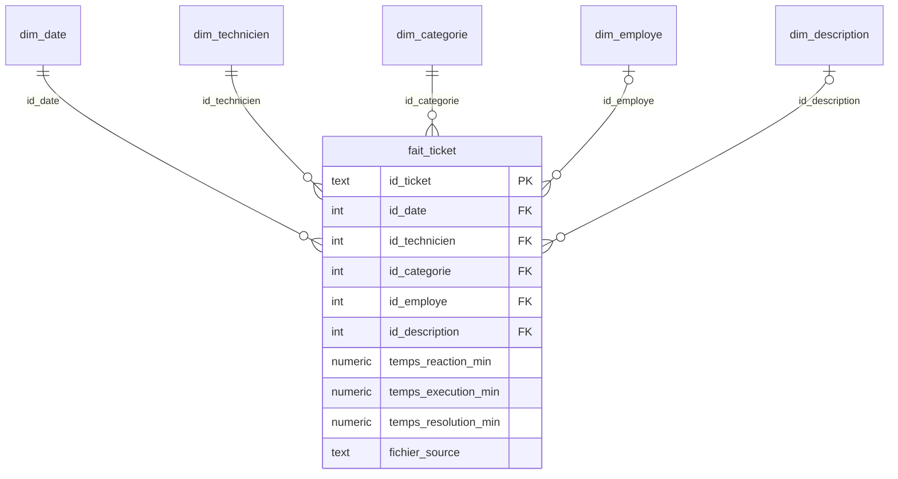
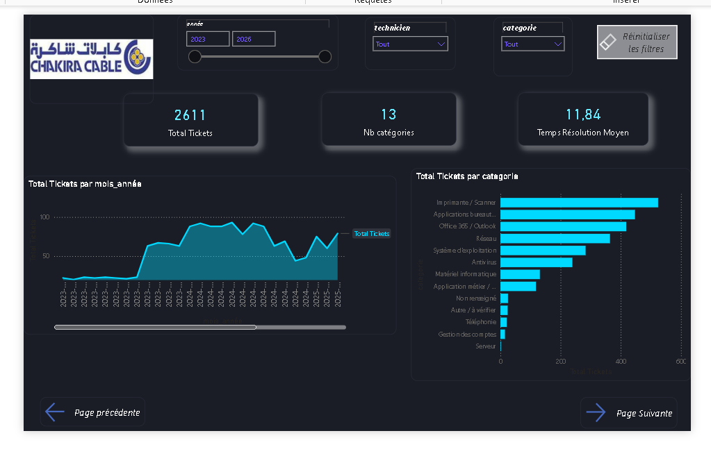
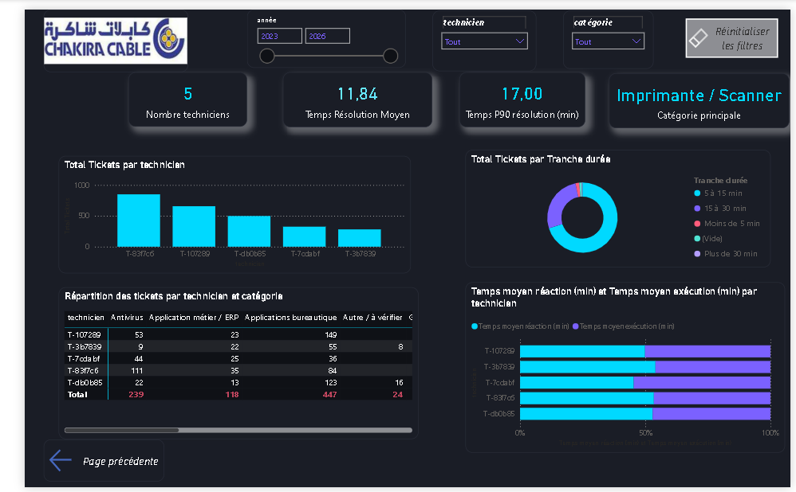

# Hotline IT Analytics

Pipeline de données et tableau de bord sur les interventions d'un service d'assistance informatique : des fichiers Excel de suivi sont extraits, nettoyés, anonymisés, chargés dans PostgreSQL, modélisés en étoile et exploités dans Power BI.

## Objectif

Les techniciens du support saisissent leurs interventions dans un fichier Excel par mois et par personne. Ces fichiers sont dispersés et non standardisés, donc inexploitables tels quels. Le projet répond à trois questions :

1. Où se concentre l'activité du support (quelles catégories d'incidents) ?
2. Combien de temps dure une intervention, et où passe ce temps ?
3. Les données sont-elles fiables, et quelles sont leurs limites ?

## Architecture

```
Excel (135 fichiers)         data/raw/, non versionné
   │  extract.py
   ▼
Bronze   données brutes (2 965 lignes)
   │  transform.py     nettoyage, typage, doublons tracés
   │  categorize.py    catégories par règles (config/categories.yml)
   │  anonymize.py     pseudonymisation
   ▼
Silver   silver.ticket (2 611 lignes) + silver.rejet (354 lignes écartées)
   │  load.py          chargement incrémental, journal ops.log_chargement
   │  build_gold.py
   ▼
Gold     schéma en étoile (fait_ticket + 5 dimensions)
   ▼
Power BI (3 pages)
```

Le tout tourne en local : PostgreSQL 16 dans Docker, pipeline en Python.

## Modèle de données



Grain de la table de faits : un ticket par ligne. `id_ticket` est un hash stable de (technicien, date, employé, description), ce qui rend le chargement rejouable sans doublon.

## Principales décisions

- **Doublons entre fichiers.** 352 lignes étaient des copies d'un autre mois (le fichier d'un mois contenait les dates d'un mois précédent). On conserve la ligne du fichier dont le nom correspond au mois de la date, et chaque ligne écartée est enregistrée avec sa raison dans `silver.rejet`.
- **Anonymisation.** Techniciens, employés et noms de fichiers sont remplacés par des pseudonymes (HMAC avec un sel secret). Les descriptions que les règles ne reconnaissent pas sont également masquées, car elles peuvent contenir un nom. Les noms réels ne figurent ni dans le code ni dans la base.
- **Bronze hors base.** La couche Bronze reste dans les fichiers Excel locaux, pour que la base ne contienne que des données déjà anonymisées.
- **Chargement incrémental.** Relancer le chargement n'insère aucune ligne en double (vérifié : `inserees=0` aux exécutions suivantes).

## Tableau de bord

Trois pages : vue d'ensemble, techniciens, qualité et limites.




## Principaux résultats

- 2 611 interventions entre janvier 2023 et juin 2026, saisies par 5 techniciens.
- Quatre catégories sur treize représentent environ 67 % des interventions : imprimante / scanner (524), applications bureautiques (447), Office 365 / Outlook (418) et réseau (364).
- Le temps moyen de résolution est de 11,8 minutes, et 90 % des interventions durent 17 minutes ou moins.
- La réaction représente environ 52 % du temps de résolution (6,1 minutes de réaction pour 5,7 minutes d'exécution). La réaction est aussi ce qui différencie le plus les techniciens.

## Limites des données

- **Le volume mensuel ne mesure pas la demande.** Chaque technicien saisit environ une intervention par jour ouvré. Le nombre de tickets par mois suit donc le nombre de techniciens présents dans les fichiers (1 en 2023, 4 ensuite), et aucune prévision de volume n'est proposée.
- **Mois sans données propres.** Février, juin et juillet 2025 n'ont aucune ligne exploitable : les fichiers correspondants contiennent des copies d'autres mois.
- **Temps saisis à la main.** Environ un quart des durées sont des multiples de 5 minutes. La résolution est exactement égale à réaction plus exécution sur toutes les lignes, donc ce sont deux mesures indépendantes, pas trois.
- **Catégories non validées manuellement.** Elles viennent de règles à mots-clés définies dans `config/categories.yml`. Les 24 descriptions non reconnues sont classées « Autre / à vérifier ».
- **Qualité de saisie.** 23 interventions n'ont pas d'employé renseigné, 1 date est invalide (1900-01-03) et une double saisie a été écartée.

## Lancer le projet

Prérequis : Python 3.11, Docker Desktop, Power BI Desktop (pour le tableau de bord).

Les fichiers Excel d'origine ne sont pas publiés. Pour rejouer le pipeline, il faut fournir des fichiers au même format dans `data/raw/Hotline/` : un fichier `.xlsx` par mois et par technicien, avec une ligne par intervention (date, employé aidé, description, temps de réaction, temps d'exécution, temps de résolution) dans les colonnes B à G.

```bash
python -m venv .venv
source .venv/bin/activate        # Windows : .venv\Scripts\Activate.ps1
pip install -r requirements.txt

cp .env.example .env             # puis renseigner ANON_SALT et le mot de passe PostgreSQL
cp config/techniciens.example.yml config/techniciens.yml   # noms à pseudonymiser

docker compose up -d
python -m src.etl.load           # extract, transform, anonymisation, chargement silver
python -m src.etl.build_gold     # schéma en étoile
python -m pytest -q              # 12 tests
```

Le sel `ANON_SALT` doit rester stable : s'il change, tous les pseudonymes changent.

## Structure du dépôt

```
config/      règles de catégorisation, liste des techniciens (exemple)
data/        données locales (non versionnées)
docs/        captures du tableau de bord
scripts/     diagnostics ponctuels
sql/         création des schémas silver et gold
src/etl/     extract, transform, categorize, anonymize, load, build_gold
tests/       tests unitaires (pytest)
```

## Pistes d'évolution

- Regroupement des variantes de descriptions (fautes de frappe) par similarité de texte.
- Contrôle qualité des temps : détection des durées atypiques par technicien et par année.
- Intégration continue (GitHub Actions) pour lancer les tests à chaque modification.